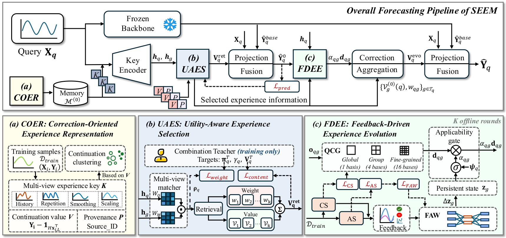

# SEEM

Code for **SEEM: Learning to Select and Evolve Experience Memory for Time Series Forecasting**.

## Framework

SEEM augments a frozen forecasting backbone with structured historical experiences. It combines correction-oriented experience representation (COER), utility-aware experience selection (UAES), and feedback-driven experience evolution (FDEE). Training and evolution use offline feedback; inference requires no newly observed ground-truth futures.



[Framework PDF](framework.pdf)

## Datasets

The repository includes seven multivariate time-series datasets.

| Dataset | Variables | Timesteps | Interval |
| --- | ---: | ---: | --- |
| ETTh1 | 7 | 17,420 | 1 hour |
| ETTh2 | 7 | 17,420 | 1 hour |
| ETTm1 | 7 | 69,680 | 15 minutes |
| ETTm2 | 7 | 69,680 | 15 minutes |
| Weather | 21 | 52,696 | 10 minutes |
| Electricity | 321 | 26,304 | 1 hour |
| Traffic | 862 | 17,544 | 1 hour |

CSV files are stored in `dataset/` and tracked with Git LFS. After cloning, run `git lfs pull` to download them. ETT uses a chronological 12/4/4-month split; the other datasets use a 7:1:2 split. Variables are standardized using training-set statistics.

## Environment

Use Python 3.10–3.12 and a CUDA-compatible PyTorch installation. Dependencies are listed in [requirements.txt](requirements.txt).

```bash
pip install -r requirements.txt
```

## Repository structure

```text
SEEM/
├── assets/
│   └── framework.png
├── configs/
├── dataset/
├── scripts/
├── seem/
│   ├── core/
│   │   ├── networks.py
│   │   ├── memory.py
│   │   ├── teacher.py
│   │   ├── evolution.py
│   │   └── ...
│   └── engines/
├── framework.pdf
├── run.py
├── summarize.py
├── README.md
└── requirements.txt
```

`core/` groups the implementation by function: `networks.py` defines the networks, `data.py` prepares inputs, `memory.py` builds experiences, `teacher.py` constructs supervision, `framework.py` and `training.py` handle retrieval and fusion, and `evolution.py` implements FDEE. `backbone.py`, `inference.py`, `cache.py`, `results.py`, `resources.py`, `runtime.py`, `utils.py`, and `pipeline.py` support training and execution. `engines/` contains dataset-specific execution logic. Experiment parameters are stored in `configs/<dataset>.json`.

## Results

```bash
python summarize.py --output-root outputs
```

Evolution selects checkpoints by validation MSE among completed round endpoints only. Intermediate logs show training and validation metrics; test metrics are printed only for the final selected result. Reports use saved metrics without post-training replay.
